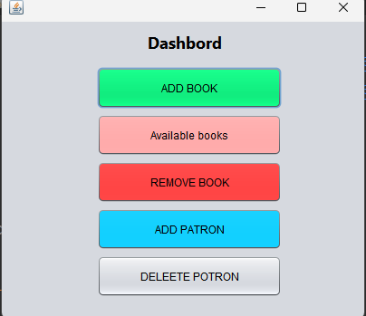
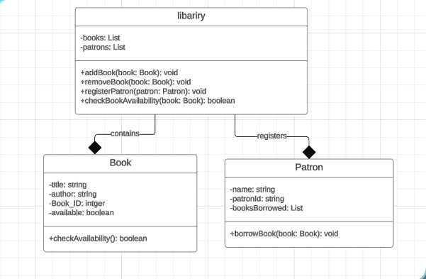
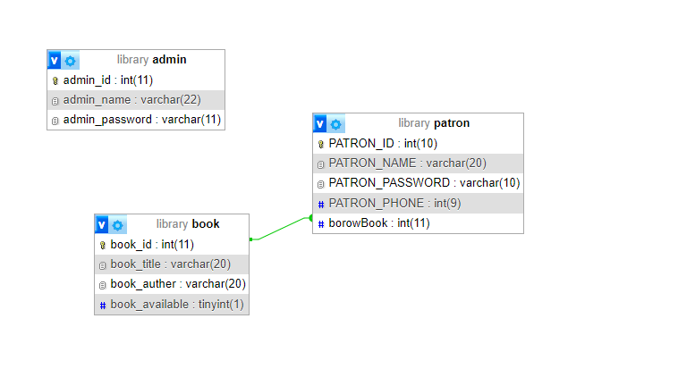
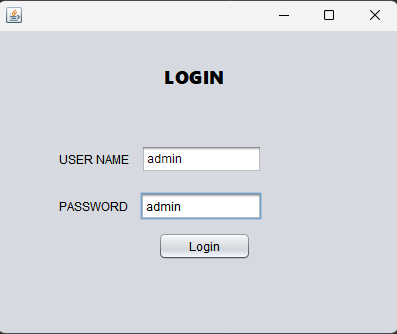
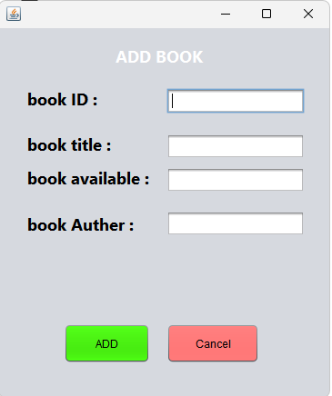
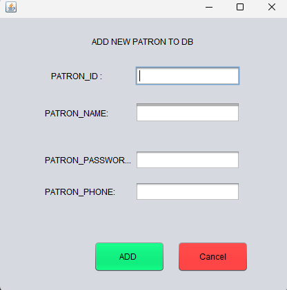
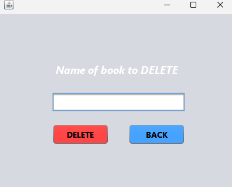
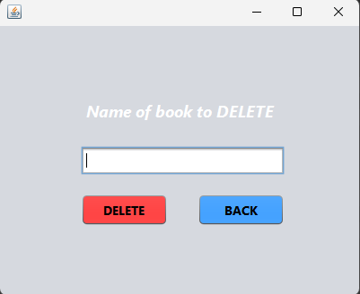

# 📚 Library Management System (Java)

A desktop library management application built with **Java Swing** and **MySQL**. Librarians log in and manage the library's books and members (patrons) from a simple dashboard.

> Java course final project (2024) — by **Hams Ali**.



---

## ✨ Features

| Feature | Description |
|---|---|
| **Admin login** | Librarian logs in with credentials stored in the `admin` table |
| **Dashboard** | One screen to reach every function |
| **Add book** | Save a new book (ID, title, author, availability) to the database |
| **Available books** | Load all books from the database into a table with one click |
| **Remove book** | Delete a book by its title |
| **Add patron** | Register a new library member (ID, name, password, phone) |
| **Delete patron** | Remove a member by name |
| **OOP model** | `Library`, `Book` and `Patron` classes based on the UML design, with a console demo |

---

## 🛠️ Tech Stack

- **Language:** Java 17+
- **GUI:** Java Swing (designed with the NetBeans GUI Builder)
- **Database:** MySQL / MariaDB (via XAMPP + phpMyAdmin)
- **Driver:** MySQL Connector/J 8.3.0 (JDBC)
- **IDE:** Apache NetBeans

---

## 📁 Project Structure

```
Library-Management-Java/
├── src/
│   ├── Login.java           # Admin login (app entry point)
│   ├── dashbord.java        # Dashboard
│   ├── Add_book.java        # Add a book
│   ├── Avaiblebook.java     # List all books
│   ├── DELETE_BOOK.java     # Remove a book
│   ├── ADD_PARON.java       # Add a patron
│   ├── Delete_PARON.java    # Delete a patron
│   ├── DB.java              # Database connection settings
│   ├── *.form               # NetBeans GUI designer files
│   └── model/               # OOP classes: Library, Book, Patron, LibraryDemo
├── database/
│   └── library.sql          # Database schema + sample data
├── docs/
│   ├── Project-Summary.pdf
│   ├── Presentation.pdf / .pptx
│   ├── uml-diagram.png
│   ├── database-diagram.png
│   └── screenshots/
├── lib/                     # Put the MySQL JDBC driver here
├── nbproject/  build.xml    # NetBeans project files
└── README.md
```

---

## 🧩 Design

### UML class diagram


### Database


| Table | Columns |
|---|---|
| `admin` | `admin_id` (PK), `admin_name`, `admin_password` |
| `book` | `book_id` (PK), `book_title`, `book_auther`, `book_available` |
| `patron` | `PATRON_ID` (PK), `PATRON_NAME`, `PATRON_PASSWORD`, `PATRON_PHONE`, `borowBook` (FK → `book.book_id`) |

---

## 🚀 How to Run

1. **Database**
   - Install [XAMPP](https://www.apachefriends.org/) and start **MySQL**.
   - Open phpMyAdmin (`http://localhost/phpmyadmin`), create a database named **`library`**, then **Import** `database/library.sql`.
2. **JDBC driver**
   - Download **MySQL Connector/J 8.3.0** ("Platform Independent" ZIP) from <https://dev.mysql.com/downloads/connector/j/>.
   - Copy `mysql-connector-j-8.3.0.jar` into the `lib/` folder.
3. **Run**
   - Open the project folder in **NetBeans** → Run (main class: `Login`).
   - Or from a terminal:
     ```bash
     javac -cp lib/mysql-connector-j-8.3.0.jar -d out src/*.java src/model/*.java
     java  -cp "out:lib/mysql-connector-j-8.3.0.jar" Login        # Windows: use ; instead of :
     ```
4. Log in with **admin / admin**.

If your MySQL user or password is not the XAMPP default (`root` / empty), change it in `src/DB.java`.

To try the OOP model without a database:
```bash
java -cp out model.LibraryDemo
```

---

## 📸 Screenshots

| Login | Dashboard | Add book |
|---|---|---|
|  |  |  |

| Add patron | Remove book | Delete patron |
|---|---|---|
|  |  |  |

---

## 📝 Notes

- The first commit contains the project exactly as originally submitted. The second commit fixes the database code so the app compiles and runs.
- Possible improvements: hash passwords, add borrowing/returning books in the GUI, edit book and patron details, and search.

📄 [Project summary](docs/Project-Summary.pdf) · 🎞️ [Presentation](docs/Presentation.pdf)
